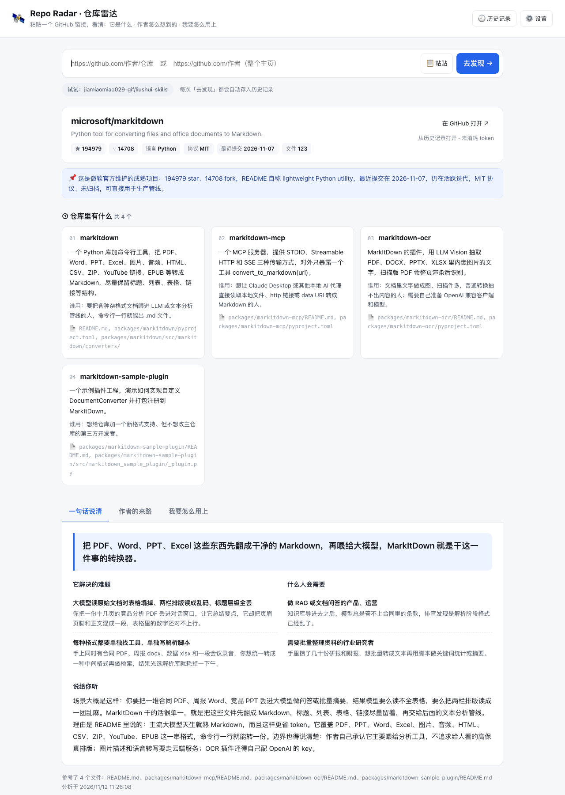
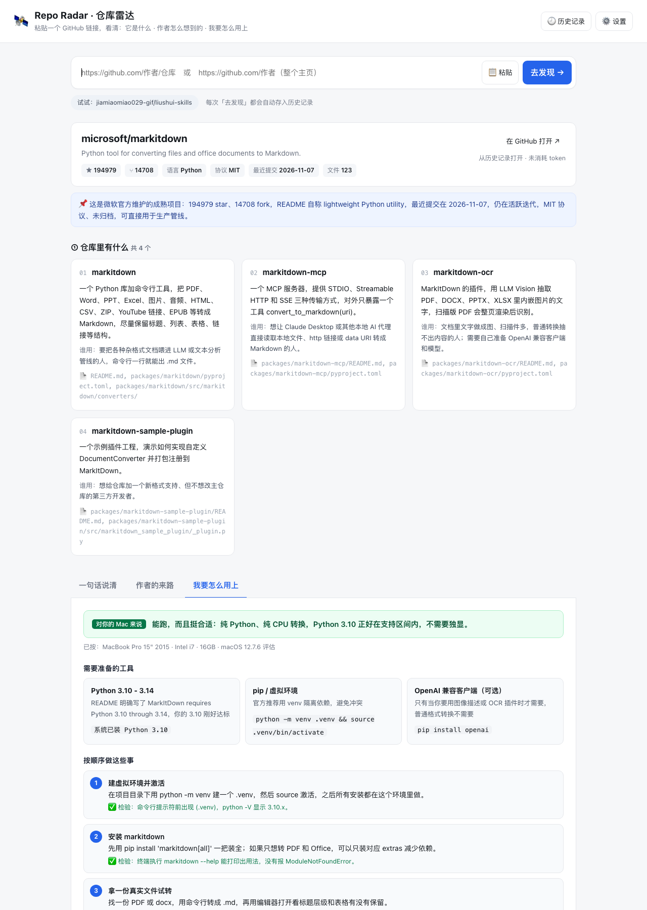

[中文](README.md) · **English**

<div align="center">

# 🛰️ Repo Radar

**Paste a GitHub link. Get the three things you actually want to know.**

What it is · Why the author built it · How to use it




</div>

## What it is

Repo Radar is a local-first **GitHub dashboard**. It takes a repository out of "programmer text" and translates it into plain language through four lenses:

| Lens | What you get |
| --- | --- |
| **① What's inside** | Product cards: how many deliverables the repo actually ships, what each one does, who it is for, with the file path that supports it |
| **② In one sentence** | A one-line positioning, the concrete problem it solves, who needs it and when, plus a short talk-through that sounds like a friend explaining it |
| **③ The author's path** | Discovered → needed → thought → built → results. Author quotes are verbatim with file paths; AI inferences are wrapped in「」 |
| **④ How I use it** | A feasibility check against your machine, then "install this, do that" — no wall of code |

Two input modes:

- **One repository**: `https://github.com/owner/repo`
- **A whole profile**: `https://github.com/owner` (with or without `?tab=repositories`). It reads up to 40 public, non-archived repos, gives each one a card, then summarizes the person's overall direction and where to start.

> There is no hosted demo: the tool needs a server to read GitHub and your API key to call the model, so it is designed to run locally. The source lives on GitHub; the server only binds to `127.0.0.1`.

## Why it exists

A lot of READMEs are written for people who already know the project: install, configure, API, flags. But someone from a product or ops background opens a repo and actually wants to know:

- What problem does this solve, and is it worth an afternoon?
- Why did the author build it? What concrete annoyance did they start from?
- Will it run on my 2015 Intel Mac? What is step one?

Repo Radar answers those in one pass — and keeps **what the author said** separate from **what the model guessed**.

## Screenshots

| Analysis result | Setup steps tuned to your machine |
| --- | --- |
|  |  |

Both screenshots come from a real analysis of `microsoft/markitdown`.

## Quick start

Requirements: **Node.js ≥ 18**. No `npm install` — zero runtime dependencies.

```bash
git clone https://github.com/JUNHAO88868/repo-radar.git
cd repo-radar

# 1. Configure a model key (either way)
cp .env.example .env.local     # then replace DEEPSEEK_API_KEY with your own
# or fill it in the page under "⚙️ Settings"; it stays in browser localStorage

# 2. Start
node server.mjs
```

Open **http://127.0.0.1:4321**.

On macOS you can also double-click **`启动.command`** (if macOS blocks it the first time: right-click → Open).

To use another model or gateway, change `LLM_BASE` / `LLM_MODEL` in `.env.local`. Any OpenAI-compatible Chat Completions endpoint works.

## How to use it

1. Copy a GitHub link and paste it into the input (or click **📋 Paste** to read the clipboard).
2. Click **去发现 →**.
3. The first analysis usually takes **40–90 seconds** (download repo text + model summary). The same repo at the same commit is cached and returns in about a second.
4. Switch between the three tabs: **In one sentence / The author's path / How I use it**.
5. At the bottom:
   - **Download PDF** — export the full report;
   - **Copy as Markdown** — paste into your notes;
   - **Re-analyze** — ignore the cache and run again.

### History

Open **🕘 History** in the top-right. Every analysis is saved automatically; the same repo at the same commit keeps one entry and is refreshed instead of duplicated. History lives in `.cache/history/` on your machine; opening an entry does not call the model or spend tokens.

### Output language

**⚙️ Settings → Output language** switches between Chinese and English. Chinese is the default.

## How it avoids making things up

- **Reads the whole repo, not just the landing README**: downloads the repo tarball once from `codeload.github.com`, prioritizes README, SKILL.md, docs, package.json (300KB per file, 80MB per repo).
- **Quotes must be verbatim**: the prompt requires author quotes to appear character-for-character in the source material, with the file path attached. Otherwise the model cannot use them.
- **Inferences must be marked**: anything the model fills in beyond the material goes into "The author's path" and is rendered in amber「」.
- **Every claim has evidence**: product cards carry an `evidence` file path you can check in the repo.
- **It admits missing material**: when the author truly did not explain a motive, it says "the author left no note at this step" instead of inventing a story.

## Configuration

Create `.env.local` in the project root (already gitignored):

| Variable | Default | Description |
| --- | --- | --- |
| `DEEPSEEK_API_KEY` | — | Required. DeepSeek API key; can also be entered in the page settings |
| `PORT` | `4321` | Local port |
| `LLM_BASE` | `https://api.deepseek.com` | OpenAI-compatible model gateway |
| `LLM_MODEL` | `deepseek-flash` | Model name |
| `MAX_TOKENS` | `24000` | Max output tokens |
| `REASONING_EFFORT` | `low` | Reasoning effort (if supported by the model) |
| `GITHUB_TOKEN` | — | Optional. Higher GitHub API quota and private repos |

## HTTP API

The server is also a small API, so you can script it:

| Method | Path | Description |
| --- | --- | --- |
| `GET` | `/api/health` | Health check: model name, whether a key is ready |
| `POST` | `/api/analyze` | `{ "url": "...", "lang": "zh", "useCache": true }` → full report |
| `GET` | `/api/history` | History list |
| `GET` | `/api/history/item?id=...` | Open one history entry |
| `DELETE` | `/api/history?id=...` | Delete one history entry |
| `GET` | `/api/peek?url=...` | Fetch and return repo text context without calling the model |

## Project layout

```text
repo-radar/
├─ server.mjs            # zero-dependency Node server: GitHub fetch, prompts, model call, cache, history, static files
├─ discover/
│  ├─ index.html         # single-page UI
│  ├─ app.js             # rendering, history, PDF / Markdown export
│  ├─ style.css
│  └─ vendor/            # html2canvas + jsPDF (local, for PDF export)
├─ test/
│  ├─ server.test.mjs    # server + error-branch self-check
│  └─ client.test.mjs    # feeds a real analysis result into the real app.js
├─ docs/                 # README screenshots
├─ .env.example
└─ 启动.command
```

## Limits

- **Public repos on github.com only**. Private repos require `GITHUB_TOKEN`.
- Repo tarballs over 80MB are skipped; binary-only repos return "not enough material".
- Profile mode reads at most 40 public repos and the first 1,400 characters of each README — good for scanning a portfolio, not for deep-diving every repo.
- Unauthenticated GitHub API allows 60 requests per hour; `GITHUB_TOKEN` raises it.
- Stars and last-commit time are snapshots taken at analysis time.
- Each analysis costs roughly 15k tokens (depending on repo size), billed to your model account.

## Privacy

- The API key stays in `.env.local` or browser `localStorage`; it is never committed.
- The server binds to `127.0.0.1`; other devices on your LAN cannot reach it.
- Data only goes to two places: `api.github.com` / `codeload.github.com` (read the repo) and your configured model endpoint (summarize it).
- Reports and history stay in `.cache/` on your machine. Delete it to clear everything.

## Self-check

```bash
# Server: health, static page, error branches, path traversal
node test/server.test.mjs

# Frontend: cards, three panels, quote blocks, buttons — fed a real result
node test/client.test.mjs /tmp/out2.json
```

## License

MIT
