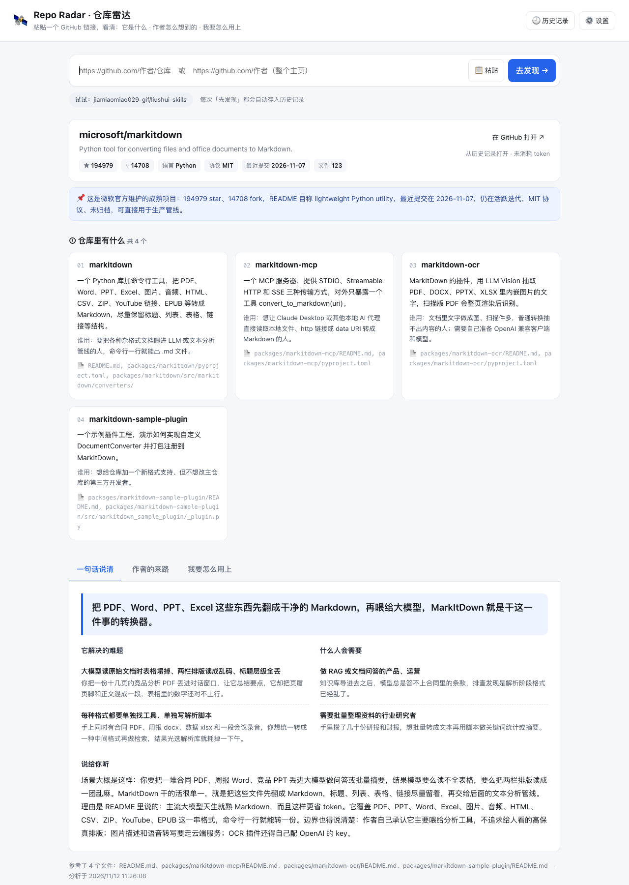
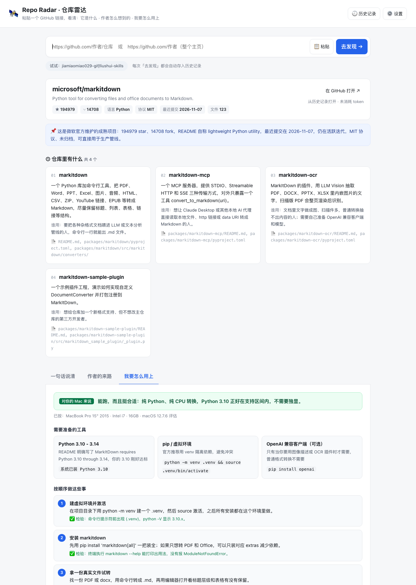

**中文** · [English](README.en.md)

<div align="center">

# 🛰️ Repo Radar · 仓库雷达

**粘贴一个 GitHub 链接，把仓库翻译成三件你真正想知道的事。**

它是什么 · 作者怎么想到的 · 我要怎么用上




</div>

## 这是什么

Repo Radar（仓库雷达）是一个跑在本机的 **Github Dashboard 仪表盘**。它把一个 GitHub 仓库从「程序文字」翻译成人话，用四个视角回答四个问题：

| 视角 | 你会看到 |
| --- | --- |
| **① 仓库里有什么** | 块状产品卡片：这个仓库到底交付了几个东西，每个是干什么的、谁会用，并附上支撑它的文件路径 |
| **② 一句话说清** | 一句话定位、它解决的具体难题、什么人会在什么时刻需要它，以及一段像朋友聊天一样的讲解 |
| **③ 作者的来路** | 发现 → 需求 → 思考 → 实践 → 结果。作者原话逐字引用并标注文件路径，AI 的推断用「」标出 |
| **④ 我要怎么用上** | 按你这台机器的配置判断可行性，只给「装什么 + 做什么」，不给大段代码 |

支持两种输入：

- **单个仓库**：`https://github.com/作者/仓库`
- **整个作者主页**：`https://github.com/作者`（`?tab=repositories` 也认）。一次读该作者全部公开仓库（最多 40 个、排除归档），每个仓库一张卡片，再给出「这个人整体在做什么 → 他的来路 → 我该从哪个开始用」。

> 在线 Demo 暂不提供：这个工具需要服务端读 GitHub、再拿你的 API Key 调模型，所以设计成本地运行。源码在 GitHub，服务只监听 `127.0.0.1`。

## 为什么做这个

很多 README 是写给「已经会用的人」的：安装、配置、API、参数。但一个产品/运营背景的人打开仓库，真正想问的是：

- 这东西到底解决什么问题，值不值得我花一个下午？
- 作者为什么做它？他是从哪个具体麻烦里走过来的？
- 我这台 2015 年的 Intel Mac 能不能跑？第一步该做什么？

Repo Radar 就是把这三件事一次讲清楚，并且**把「作者说的」和「模型猜的」分开**。

## 截图

| 分析结果 | 按你的机器给出上手步骤 |
| --- | --- |
|  |  |

截图来自真实分析：`microsoft/markitdown`。

## 快速开始

要求：**Node.js ≥ 18**，不需要 `npm install`，项目零运行时依赖。

```bash
git clone https://github.com/JUNHAO88868/repo-radar.git
cd repo-radar

# 1. 配置模型 Key（二选一）
cp .env.example .env.local     # 然后把 DEEPSEEK_API_KEY 换成你自己的
# 或者启动后在页面右上角「⚙️ 设置」里填，只存在浏览器 localStorage

# 2. 启动
node server.mjs
```

浏览器打开 **http://127.0.0.1:4321**。

macOS 也可以直接双击 **`启动.command`**（第一次若被系统拦截：右键 → 打开）。

想要换模型或网关，改 `.env.local` 里的 `LLM_BASE` / `LLM_MODEL`；任何兼容 OpenAI Chat Completions 的服务都能接。

## 怎么用

1. 复制一个 GitHub 链接，粘贴进输入框（或点 **📋 粘贴** 读剪贴板）。
2. 点 **去发现 →**。
3. 第一次分析通常 **40–90 秒**（要下载整仓文本 + 模型归纳）；同一仓库同一版本再点会走缓存，约 1 秒出。
4. 用三个标签页切换「一句话说清 / 作者的来路 / 我要怎么用上」。
5. 底部可以：
   - **下载查阅（PDF）**：把完整报告导出成 PDF；
   - **复制为 Markdown**：贴进笔记；
   - **重新分析**：忽略缓存再跑一次。

### 历史记录

入口在右上角 **🕘 历史记录**。每次分析都会自动保存；同一仓库同一版本只保留一条，重复点击只刷新内容。记录存在本机 `.cache/history/`，点开不调用模型、不消耗 token。

### 输出语言

页面右上角 **⚙️ 设置 → 输出语言** 可切中文 / English。默认中文。

## 它怎么做到「不瞎编」

- **读整仓，不只看首页**：通过 `codeload.github.com` 一次拉取仓库压缩包，按优先级读 README、SKILL.md、docs、package.json 等文本文件（单文件上限 300KB，整仓上限 80MB）。
- **原话必须逐字**：提示词强制作者引用必须能在材料里逐字找到，并标注来源文件路径；找不到就不能写。
- **推断必须标记**：作者没写、由模型补的脉络，只能放在「作者的来路」里并标为推断，前端用琥珀色「」显示。
- **每个结论带证据**：产品卡片附 `evidence` 文件路径，可以点回仓库核对。
- **材料不足就承认**：作者确实没写动机时，显示「作者在这一步没留下说明」，而不是编故事。

## 配置项

在项目根目录新建 `.env.local`（已被 `.gitignore` 忽略）：

| 变量 | 默认值 | 说明 |
| --- | --- | --- |
| `DEEPSEEK_API_KEY` | — | 必填。DeepSeek API Key；也可在页面设置里临时填 |
| `PORT` | `4321` | 本地端口 |
| `LLM_BASE` | `https://api.deepseek.com` | 兼容 OpenAI 协议的模型网关 |
| `LLM_MODEL` | `deepseek-flash` | 模型名 |
| `MAX_TOKENS` | `24000` | 单次输出上限 |
| `REASONING_EFFORT` | `low` | 推理强度（视模型支持） |
| `GITHUB_TOKEN` | — | 可选。提高 GitHub API 配额、读私有仓库 |

## HTTP 接口

服务同时是一个小型 API，方便脚本调用：

| 方法 | 路径 | 说明 |
| --- | --- | --- |
| `GET` | `/api/health` | 健康检查，返回模型名与 Key 是否就绪 |
| `POST` | `/api/analyze` | `{ "url": "...", "lang": "zh", "useCache": true }`，返回完整报告 |
| `GET` | `/api/history` | 历史记录列表 |
| `GET` | `/api/history/item?id=...` | 打开一条历史记录 |
| `DELETE` | `/api/history?id=...` | 删除一条历史记录 |
| `GET` | `/api/peek?url=...` | 只抓取并返回仓库文本上下文，不调用模型 |

## 项目结构

```text
repo-radar/
├─ server.mjs            # 零依赖 Node 服务：GitHub 抓取、提示词、模型调用、缓存、历史、静态服务
├─ discover/
│  ├─ index.html         # 单页界面
│  ├─ app.js             # 渲染、历史、PDF / Markdown 导出
│  ├─ style.css
│  └─ vendor/            # html2canvas + jsPDF（本地打包，PDF 导出用）
├─ test/
│  ├─ server.test.mjs    # 服务端与错误分支自检
│  └─ client.test.mjs    # 用真实分析结果喂真实 app.js 的前端渲染自检
├─ docs/                 # README 截图
├─ .env.example
└─ 启动.command
```

## 边界

- **只支持 github.com 的公开仓库**。私有仓库需要配置 `GITHUB_TOKEN`。
- 仓库压缩包 > 80MB 不支持；纯二进制仓库没有可分析文本时会提示「材料不足」。
- 作者主页模式最多读 40 个公开仓库、每个仓库只读 README 前 1400 字符，适合快速扫作品集，不适合逐仓深挖。
- 未登录的 GitHub API 每小时 60 次；配置 `GITHUB_TOKEN` 可提高。
- Star、最近提交时间都是分析那一刻的快照。
- 每次分析约消耗 1.5 万 token（视仓库大小），费用由你的模型账户承担。

## 隐私

- API Key 只存在本机 `.env.local` 或浏览器 `localStorage`，不会提交到仓库。
- 服务只监听 `127.0.0.1`，局域网内的其他设备访问不到。
- 数据只发往两个地方：`api.github.com` / `codeload.github.com`（读仓库）和你配置的模型接口（做归纳）。
- 分析结果与历史记录都在本机 `.cache/`，删掉即清空。

## 自检

```bash
# 服务端：健康检查、静态页、错误分支、路径穿越
node test/server.test.mjs

# 前端：用一份真实分析结果验证卡片、三块内容、引用块、按钮
node test/client.test.mjs /tmp/out2.json
```

## License

MIT
